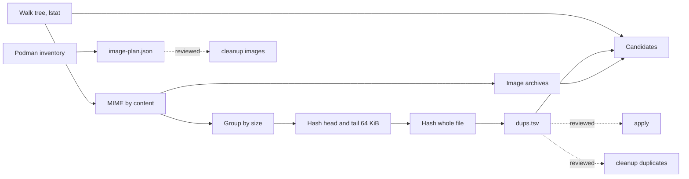

# Design

## Pipeline

`scan` reads input files, stages reports in a private temporary directory and
publishes selected formats under `-out`; that directory is excluded from the
walk. Final report files are reserved exclusively and never replace existing
files. `apply` changes files from a reviewed plan and writes its operation
manifest under `-quarantine`.

## Duplicate detection

Candidates share a size of at least `-min-size`. A cheap sample (first and last
64 KiB plus the size) removes most non-duplicates before the full xxh3-128
hash. The hash identifies candidates; it is not trusted for destruction. In
`dedupe` mode the kernel compares the bytes again.

Hardlinks (same device and inode) are one file. Files under `.git/` and files
modified within `-settle` are never candidates.

## Why `apply` does not delete

| Risk | Handling |
| --- | --- |
| Software refers to a duplicate's path | `dedupe` keeps every path |
| The file changed after the scan | `apply` compares size and mtime and skips |
| Hash collision | `dedupe` uses the kernel's byte comparison |
| Wrong copy kept | the plan is reviewed text; `quarantine` is reversible by moving back |
| Free space during the operation | both modes work on one filesystem, no copy is made |

`dedupe` uses `FIDEDUPERANGE`. Deleting one of two extent-sharing files frees
no space until the other is gone as well.
Replacing two independently allocated identical extents with one shared
extent can free space immediately. Logical duplicate totals do not measure
that gain; already shared extents and sparse files can reduce it to zero.

## Explicit cleanup

`cleanup` is a separate deletion command, with dry run as its default.
Duplicate cleanup opens single-link regular files through pinned directory
descriptors, compares complete contents and rechecks identity. Execution
claims a duplicate into a private same-directory location, compares again
and unlinks it. Refused claims are restored without replacing another file;
failed restoration retains a recovery copy whose path appears in the report.
A process crash can leave a private claim directory. Inspect it before retrying.

Image cleanup binds a reviewed exact-ID plan to one owner, Unix socket and
store. Fresh image and container inventories precede each removal. Only
unnamed dangling images without child images or container references qualify;
SDK removal disables force, ignore and parent pruning.

Both operations reserve selected JSON, JSONL or Markdown reports before
mutation and preserve completed outcomes on an operational error. Report
write failures remain errors; a crash can leave incomplete report files.
Logical byte totals do not establish physically recovered disk space.

## MCP boundary

The stdio server exposes the same CLI operations through typed tools. Startup
fixes the data root, separate report parent and image owner/socket. Each call
gets a private report directory; cleanup plans are snapshotted and validated
before invoking a bounded, cancellable child process. Data deletion requires
both a startup execution gate and an explicit per-call execution argument.
Path checks assume quiet directories and are not a sandbox against concurrent
directory moves. See [Use the local MCP server](../howto/use-mcp.md).

## Tiers

Tier 1 is content that exists elsewhere or has junk names. Tier 2 needs a
human check: image archives (local storage is not a backup) and caches. Tier 3
is a decision about age or regenerability. Cold vendor media is a library, not
garbage: tier 3 lists it for visibility only.

## Limits

- The walk is single-threaded; hashing and MIME detection run in parallel.
- MIME uses the first 3 KiB of a file.
- Image matching compares image IDs; layers are not compared across images.
- Failed requested image stores are explicitly unavailable; they cannot
  establish that an unmatched archive is absent.
- Apply requires reviewed, quiet files and parent directories; a scan is not
  a filesystem snapshot or a lock against concurrent writers.
- Windows and macOS are not supported.
